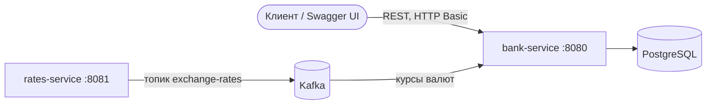
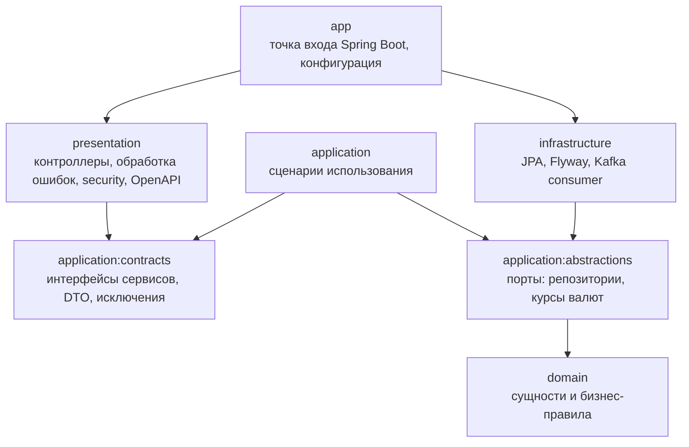

# Bank Microservices

[](https://github.com/A1bic/bank-microservices/actions/workflows/ci.yml)


REST API банка из двух микросервисов:

- **bank-service** — пользователи и роли, друзья, банковские счета, пополнение и снятие, переводы с комиссией,
  история операций, баланс в другой валюте;
- **rates-service** — публикует курс валюты в Kafka, bank-service подхватывает его и пересчитывает балансы.

## Возможности

- Аутентификация через форму логина (удобно для Swagger UI) и HTTP Basic (удобно для curl), пароли хранятся в BCrypt.
- Роли `ADMIN` (управляет пользователями) и `CLIENT` (работает со своими счетами и друзьями).
- Переводы с комиссией: **0%** между своими счетами, **3%** другу, **10%** всем остальным.
  Комиссия списывается с отправителя сверх суммы перевода.
- Баланс и история операций в любой валюте, курс которой пришёл из Kafka (`?currency=USD`).
- История операций с фильтром по типу; входящий перевод виден получателю, исходящий — отправителю.
- Все ошибки в едином формате [RFC 9457 Problem Details](https://www.rfc-editor.org/rfc/rfc9457)
  с машиночитаемым `errorCode`.
- Документация API в Swagger UI (OpenAPI 3).

## Технологии

| Область        | Что используется                                                         |
|----------------|--------------------------------------------------------------------------|
| Язык и сборка  | Java 21, Gradle (multi-module, version catalog)                          |
| Фреймворк      | Spring Boot 3.5: Web, Security, Data JPA, Validation, Actuator           |
| Данные         | PostgreSQL 16, Hibernate, Flyway, MapStruct                              |
| Сообщения      | Apache Kafka (KRaft), Spring for Apache Kafka                            |
| Документация   | springdoc-openapi (Swagger UI)                                           |
| Тесты          | JUnit 5, Mockito, AssertJ, Testcontainers, Spring Security Test, MockMvc |
| Инфраструктура | Docker, Docker Compose, GitHub Actions                                   |

## Архитектура



bank-service разделён на модули по слоям Clean Architecture. Зависимости направлены внутрь, к домену:



| Модуль                                 | Ответственность                                                                         |
|----------------------------------------|-----------------------------------------------------------------------------------------|
| `bank-service/domain`                  | `Account`, `Transaction`, `User`, `Money`. Проверка баланса, пополнение, списание       |
| `bank-service/application/abstractions` | Интерфейсы (порты) репозиториев и провайдера курсов валют                               |
| `bank-service/application/contracts`   | Публичный API слоя приложения: `AccountService`, `UserService`, операции, DTO           |
| `bank-service/application`             | Реализация сценариев: переводы и комиссии, конвертация валют, дружба                    |
| `bank-service/infrastructure`          | Адаптеры: JPA-сущности и репозитории, MapStruct-маппинг, миграции Flyway, Kafka-консьюмер |
| `bank-service/presentation`            | REST-контроллеры, валидация запросов, Spring Security, обработка ошибок, OpenAPI         |
| `bank-service/app`                     | Spring Boot приложение, `application.yml`, интеграционные тесты                          |
| `rates-service`                        | По расписанию публикует курс валюты в Kafka                                             |

## Быстрый старт

Нужен только Docker.

```bash
docker compose up --build
```

| Что                | Где                                                                          |
|--------------------|------------------------------------------------------------------------------|
| Swagger UI         | http://localhost:8080/swagger-ui.html (логин `admin` / пароль `admin`)       |
| bank-service       | http://localhost:8080                                                        |
| rates-service      | http://localhost:8081/actuator/health                                        |
| PostgreSQL         | `localhost:5434`, база `bank`, пользователь `bank` / `bank`                  |
| Kafka              | `localhost:9092`                                                             |
| Kafka UI (опционально) | `docker compose --profile tools up` → http://localhost:8090              |

При первом запуске создаётся администратор `admin` / `admin`.
Логин и пароль можно поменять переменными окружения `BANK_ADMIN_LOGIN` и `BANK_ADMIN_PASSWORD`.

## Пример: перевод между клиентами

```bash
# Администратор создаёт двух клиентов (в ответе приходит id пользователя: 2 и 3)
curl -u admin:admin -H 'Content-Type: application/json' http://localhost:8080/api/users \
  -d '{"login":"alice","password":"alice123","name":"Alice","age":25,"gender":"FEMALE","hairColor":"red","role":"CLIENT"}'
curl -u admin:admin -H 'Content-Type: application/json' http://localhost:8080/api/users \
  -d '{"login":"bob","password":"bob12345","name":"Bob","age":30,"gender":"MALE","hairColor":"black","role":"CLIENT"}'

# Клиенты открывают счета (id счетов: 1 и 2)
curl -u alice:alice123 -H 'Content-Type: application/json' http://localhost:8080/api/users/2/accounts \
  -d '{"initialBalance":1000}'
curl -u bob:bob12345 -H 'Content-Type: application/json' http://localhost:8080/api/users/3/accounts \
  -d '{"initialBalance":0}'

# Перевод незнакомому человеку: комиссия 10%, с Alice списывается 110
curl -u alice:alice123 -H 'Content-Type: application/json' http://localhost:8080/api/transfers \
  -d '{"fromAccountId":1,"toAccountId":2,"amount":100}'

# Alice добавляет Bob в друзья, теперь комиссия 3%
curl -u alice:alice123 -X POST http://localhost:8080/api/users/2/friends/3
curl -u alice:alice123 -H 'Content-Type: application/json' http://localhost:8080/api/transfers \
  -d '{"fromAccountId":1,"toAccountId":2,"amount":100}'

# Баланс в рублях и в долларах по текущему курсу из rates-service
curl -u alice:alice123 http://localhost:8080/api/accounts/1/balance
curl -u alice:alice123 'http://localhost:8080/api/accounts/1/balance?currency=USD'

# История операций получателя
curl -u bob:bob12345 http://localhost:8080/api/accounts/2/transactions
```

Пример ошибки:

```json
{
  "type": "about:blank",
  "title": "Insufficient funds",
  "status": 400,
  "detail": "Insufficient funds: balance = 787.00, required = 5150.00",
  "instance": "/api/transfers",
  "errorCode": "INSUFFICIENT_FUNDS"
}
```

## API

Все эндпоинты требуют аутентификации. Полное описание — в Swagger UI.

| Метод    | Путь                                       | Роль   | Описание                                         |
|----------|--------------------------------------------|--------|--------------------------------------------------|
| `GET`    | `/api/auth/me`                             | любая  | Текущий пользователь и его роли                  |
| `POST`   | `/api/users`                               | ADMIN  | Создать пользователя                             |
| `GET`    | `/api/users`                               | ADMIN  | Все пользователи                                 |
| `GET`    | `/api/users/{userId}`                      | ADMIN  | Пользователь по id                               |
| `GET`    | `/api/users/search?gender=&hairColor=`     | ADMIN  | Поиск по полу и цвету волос                      |
| `GET`    | `/api/users/{userId}/friends`              | CLIENT | Друзья пользователя                              |
| `POST`   | `/api/users/{userId}/friends/{friendId}`   | CLIENT | Добавить в друзья (дружба взаимная)              |
| `DELETE` | `/api/users/{userId}/friends/{friendId}`   | CLIENT | Удалить из друзей                                |
| `POST`   | `/api/users/{userId}/accounts`             | CLIENT | Открыть счёт                                     |
| `GET`    | `/api/users/{userId}/accounts`             | CLIENT | Счета пользователя                               |
| `GET`    | `/api/accounts/{accountId}`                | CLIENT | Счёт по id                                       |
| `GET`    | `/api/accounts/{accountId}/balance`        | CLIENT | Баланс, опционально `?currency=USD`              |
| `GET`    | `/api/accounts/{accountId}/transactions`   | CLIENT | История, опционально `?type=DEPOSIT&currency=USD` |
| `POST`   | `/api/accounts/{accountId}/deposit`        | CLIENT | Пополнить счёт                                   |
| `POST`   | `/api/accounts/{accountId}/withdraw`       | CLIENT | Снять деньги                                     |
| `POST`   | `/api/transfers`                           | CLIENT | Перевести деньги на другой счёт                  |

## Разработка

Запустить инфраструктуру в Docker, а bank-service — локально (например, из IDE):

```bash
docker compose up -d postgres kafka rates-service
./gradlew :bank-service:app:bootRun
```

Сборка и тесты:

```bash
./gradlew build
```

Интеграционные тесты поднимают PostgreSQL через Testcontainers, поэтому для них нужен запущенный Docker.

Схема базы данных описана миграциями Flyway в
[`bank-service/infrastructure/src/main/resources/db/migration`](bank-service/infrastructure/src/main/resources/db/migration),
Hibernate только проверяет, что сущности ей соответствуют (`ddl-auto: validate`).

## Структура репозитория

```
.
├── bank-service
│   ├── domain                      # бизнес-модель
│   ├── application
│   │   ├── abstractions            # порты
│   │   ├── contracts               # API слоя приложения
│   │   └── src                     # реализация сервисов
│   ├── infrastructure              # JPA, Flyway, Kafka
│   ├── presentation                # REST, security, OpenAPI
│   ├── app                         # Spring Boot приложение и интеграционные тесты
│   └── Dockerfile
├── rates-service                   # публикация курсов валют
│   └── Dockerfile
├── gradle/libs.versions.toml       # версии зависимостей
├── docker-compose.yml
└── .github/workflows/ci.yml        # сборка, тесты и Docker-образы в GitHub Actions
```
